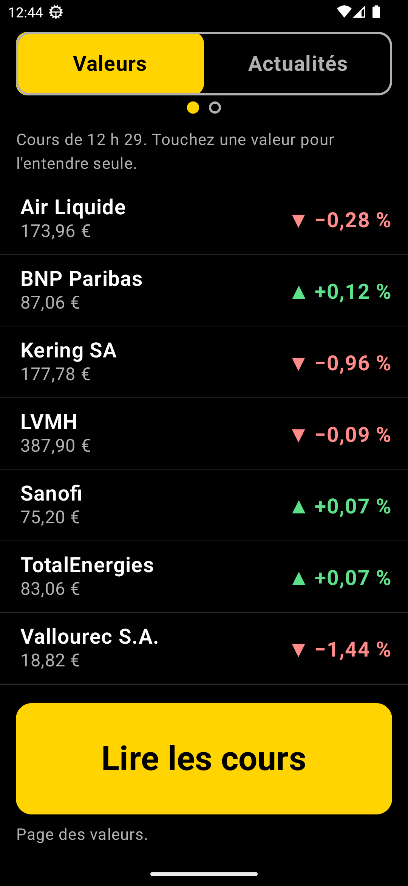
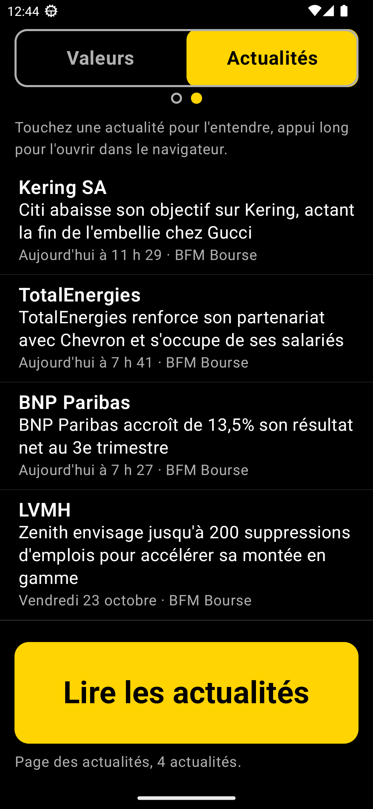

# Bourse Vocale

Application Android qui lit à voix haute, en français, les cours d'une liste de valeurs boursières et leurs dernières actualités. Pensée pour une personne malvoyante : tout est utilisable sans lire l'écran.

  
  &nbsp;&nbsp;
  

- **Valeurs** : le gros bouton jaune lit tous les cours ; toucher une valeur la lit seule. Le bouton vert ajoute une valeur, par dictée vocale.
- **Actualités** (glisser vers la gauche) : le bouton jaune lit les titres, avec la date et la source ; toucher une actualité lit l'article, un appui long propose de l'ouvrir dans le navigateur.

Chaque page s'annonce à voix haute quand on y arrive. La voix et la vitesse de lecture sont celles réglées dans Android (Paramètres → Accessibilité → Synthèse vocale).

## Installer

Sur le téléphone Android, toucher ce lien :

**[Télécharger la dernière version](https://github.com/FrancoisPellet/bourse-vocale-releases/releases/latest/download/bourse-vocale.apk)**

Au premier téléchargement, Android demande d'autoriser l'installation depuis le navigateur : accepter, puis ouvrir le fichier.

Pour les mises à jour, le même lien donne toujours la dernière version. L'application [Obtainium](https://github.com/ImranR98/Obtainium) peut aussi les proposer automatiquement : y ajouter l'adresse de ce dépôt.

Ce dépôt ne contient que les APK publiés ; le code source est privé.
